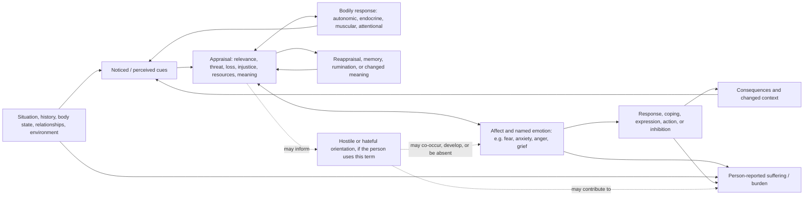

# Perception, stress, emotion, and suffering

**Status:** conceptual working model, version 0.1. This is a reflective systems map, not a psychological theory validated as a whole, a diagnostic model, or a causal account of an individual.

## Purpose

Metheus can help someone inspect how they experienced a situation and what followed, while keeping the situation, their interpretation, bodily responses, emotions, actions, and meaning distinct. The sequence “perception → stress → anxiety → anger → hate → suffering” is a useful question, but should not be encoded as a universal or inevitable chain.

Stress appraisal and emotion unfold dynamically. Different people can appraise the same situation differently; appraisals, affect, coping, physiology, and later reappraisal can influence one another. The available research anchors below examine bounded tasks or emotion-process theory; they do not validate this entire pathway for all people or settings.

## Working map

The dotted paths are optional hypotheses, not prerequisites or diagnoses. “Hate” is not modeled as the inevitable late stage of anger. It may be a person's label for an intense feeling, a sustained judgment, a social or political stance, or something else; record what the person means rather than imposing a definition. A hateful attitude does not, by itself, establish intent or action. Suffering is not reserved for the end of a sequence: a person may experience suffering with or without anxiety, anger, or hate, and consequences can affect the whole loop.

## Keep the layers separate

| Layer | What Metheus may represent | What it must not assume |
|---|---|---|
| Situation / cue | A reported or observed event, relationship interaction, sensory input, bodily sensation, or circumstance; source and time | That the record captures the whole situation or another person's intent |
| Perception | What the person says they noticed, attended to, remembered, or sensed | That a perception is either objectively complete or mistaken |
| Appraisal | The person's own meaning at the time, such as danger, loss, injustice, challenge, care, or insufficient resources | One correct appraisal, stable personality, or that an appraisal was conscious before bodily response |
| Stress | Separate the person's label of feeling stressed, the stressor/context, and any measured/estimated response | A single biological quantity called “stress,” or a cortisol/HRV value as a direct stress score |
| Emotion / affect | The person's selected words for felt experience, including anxiety, anger, fear, sadness, relief, numbness, or mixed states | That an emotion is a diagnosis, is fully explained by hormones, or has one required behavior |
| Bodily response | Direct measurements or reported sensations with source, time, method, and uncertainty | A one-to-one mapping from heart rate, HRV, cortisol, sleep, or other signals to a specific emotion |
| Hostility / hate | Only the person's own chosen description, with optional distinction between momentary feeling, enduring stance, target category, and action | A compulsory phase, moral judgment about the person, prediction of violence, or attribution to a third party without their account |
| Suffering / burden | The person's report of distress, pain, loss, impairment, meaning, or burden in their own terms | That suffering is measurable from a biomarker, proportional to a stressor, or proof of a particular cause |
| Response / coping | What the person did, wanted to do, avoided, expressed, restrained, or could not do; include constraints and consequences | Agency, safety, effectiveness, or voluntariness where not reported |

## Relation vocabulary for future records

The current observation contract can hold a self-reported experience as a generic observation. The draft [experience-pathway schema](../schema/experience-pathway.schema.json) now provides a subject-controlled graph over separately sourced records, and a synthetic [example](../examples/experience-pathway-synthetic.example.json) shows branching, bypass, co-occurrence, person-reported links, and reappraisal. It is a representation contract only; no runtime builder or analyzer exists. Its relation vocabulary distinguishes:

- `temporal_order`: one record happened before another;
- `co_occurrence`: records overlap a declared window;
- `person_reported_link`: the person says one experience influenced or meant something in relation to another;
- `literature_mechanism`: a general, sourced mechanism within a bounded population/context;
- `model_hypothesis`: a clearly marked, unresolved relation proposed for exploration;
- `reappraisal`: a person-reported later reinterpretation of an earlier appraisal;
- `within_person_association`: a future relation requiring repeated-data analysis with a declared method and uncertainty; it is not yet supported by this contract.
- There is deliberately no causal-effect edge in this draft contract. Causal estimation requires an appropriate design, assumptions, and review; it cannot be represented as a casual link between two episode nodes.

One episode can support temporal ordering and the person's report of a link. It cannot by itself establish a mechanism or causal effect. A general mechanism does not establish that it occurred in one person's episode. Promethean features can, if invited, supply a reflective question but cannot be inserted into the biological or emotional pathway as a cause.

## A Metheus episode record sequence

For a person who chooses to explore an episode, a future flow might let them add separate, revisable entries:

1. The situation or cue, including uncertainty about what was observed versus inferred.
2. What they noticed and how they appraised it, in their words.
3. Felt emotions and bodily sensations, allowing several, changing, or unknown answers.
4. Any measured signals, stored as independent records with device/assay, time, and method.
5. Their response, coping, constraint, or choice not to act.
6. Consequences, experienced suffering or relief, and any later reappraisal.

Do not force completion of every step, require graphic or intimate detail, score a person, or use the pathway to predict behavior. A person can skip, correct, rename, hide, or delete optional reflections. Child-focused use requires age-appropriate assent, stewardship, and safeguards before any product collection.

## Evidence and boundaries

Stress appraisal studies support treating stress encounters and appraisals as dynamic and context-sensitive rather than as a single fixed event; for example, a naturalistic examination study measured change across anticipation, examination, and outcome stages ([Folkman & Lazarus, 1985](https://pubmed.ncbi.nlm.nih.gov/2980281/)). Experimental studies have tested appraisal and physiological response relations under bounded manipulations, rather than establishing a universal order between mind and body ([Tomaka et al., 1997](https://pubmed.ncbi.nlm.nih.gov/9216079/)). Emotion-process research distinguishes appraisal, action tendencies, physiological response, conscious feeling, and emotion labeling; that framework also emphasizes interactions among components ([Scherer & Moors, 2019](https://pubmed.ncbi.nlm.nih.gov/30110576/)). These sources motivate separation and feedback in the design; they do not validate the proposed “hate → suffering” link or a clinical use of Metheus.

The existing endocrine reference discusses HPA and sympathetic pathways, but those are only possible co-occurring response systems. Subjective stress, anxiety, anger, hate, and suffering are not hormone assays. Wearable or lab signals must remain separate from the person's reported experience, and no psychological state should be inferred from one biomarker.

## Current implementation status

The page and schema are conceptual only. The generic observation schema can represent selected self-reports, bodily measures, and contextual events; the new graph contract can reference these records while keeping nodes and relations distinct. There is no specialized episode-capture workflow, association model, causal model, or clinical tool. Maps default to private and are subject-controlled; explicit sharing is represented only as user-authorized sharing intent and does not implement access control. Any future runtime must verify that every referenced record exists, belongs to the same subject, is authorized, and has a compatible source/time basis before displaying or analyzing the graph.

Related: [ontology](ontology.md), [model core](model-core-spec.md), [measurement landscape](measurement-landscape.md), [hormone reference](hormone-reference.md), and [reading grammar](reading-grammar.md).
