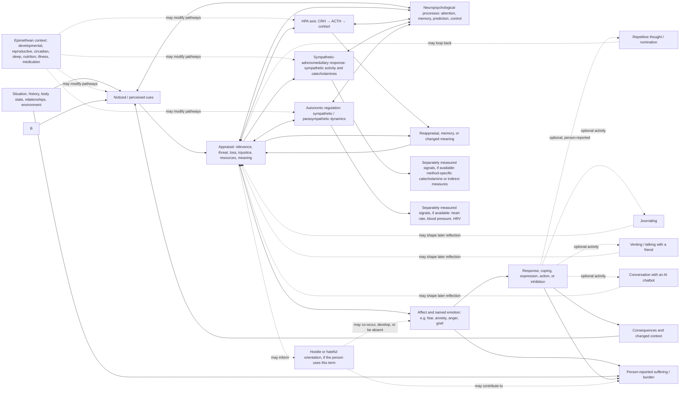

# Perception, stress, emotion, and suffering

**Status:** conceptual working model, version 0.1. This is a reflective systems map, not a psychological theory validated as a whole, a diagnostic model, or a causal account of an individual.

## Purpose

Metheus can help someone inspect how they experienced a situation and what followed, while keeping the situation, their interpretation, bodily responses, emotions, actions, and meaning distinct. The sequence “perception → stress → anxiety → anger → hate → suffering” is a useful question, but should not be encoded as a universal or inevitable chain.

Stress appraisal and emotion unfold dynamically. Different people can appraise the same situation differently; appraisals, affect, coping, physiology, and later reappraisal can influence one another. The available research anchors below examine bounded tasks or emotion-process theory; they do not validate this entire pathway for all people or settings.

## Working map

This adds a **psychoneuroendocrine layer** to the reflective map. It is a literature-informed set of candidate pathways, not a claim that any one person's appraisal must produce a particular hormone response. Perception, attention, memory, appraisal, felt emotion, autonomic regulation, and endocrine responses can unfold on different time scales and feed back; the diagram is a map of separable processes, not a mandatory temporal sequence. For example, acute social-evaluative threat increased cortisol and cardiovascular responses in one randomized laboratory speech-task study, while a separate controlled study found sympathetic reactivity predicted HPA reactivity but reported appraisal and affect did not predict later physiological reactivity in that sample ([social-evaluative threat experiment](https://pubmed.ncbi.nlm.nih.gov/30029158/); [staged response experiment](https://pubmed.ncbi.nlm.nih.gov/31382169/)).

**Endocrine interpretation stays system-specific.** The HPA axis is a multi-step regulatory pathway (hypothalamic CRH, pituitary ACTH, adrenal cortisol) with feedback; cortisol is one output, not a universal stress meter. Sympathetic-adrenomedullary signaling and parasympathetic/autonomic regulation have different mediators and time courses. Heart rate, HRV, sleep, and subjective stress are not assays of cortisol, adrenaline, noradrenaline, oxytocin, or a named emotion. A single measurement cannot validate the whole pathway. Preserve specimen/device, method, collection time, context, medication and other relevant covariates, and uncertainty. The existing [hormone reference](hormone-reference.md) gives broader assay and developmental caveats.

The dotted paths are optional hypotheses, not prerequisites or diagnoses. “Hate” is not modeled as the inevitable late stage of anger. It may be a person's label for an intense feeling, a sustained judgment, a social or political stance, or something else; record what the person means rather than imposing a definition. A hateful attitude does not, by itself, establish intent or action. Suffering is not reserved for the end of a sequence: a person may experience suffering with or without anxiety, anger, or hate, and consequences can affect the whole loop.

## Keep the layers separate

| Layer | What Metheus may represent | What it must not assume |
|---|---|---|
| Situation / cue | A reported or observed event, relationship interaction, sensory input, bodily sensation, or circumstance; source and time | That the record captures the whole situation or another person's intent |
| Perception | What the person says they noticed, attended to, remembered, or sensed | That a perception is either objectively complete or mistaken |
| Appraisal | The person's own meaning at the time, such as danger, loss, injustice, challenge, care, or insufficient resources | One correct appraisal, stable personality, or that an appraisal was conscious before bodily response |
| Stress | Separate the person's label of feeling stressed, the stressor/context, and any measured/estimated response | A single biological quantity called “stress,” or a cortisol/HRV value as a direct stress score |
| Emotion / affect | The person's selected words for felt experience, including anxiety, anger, fear, sadness, relief, numbness, or mixed states | That an emotion is a diagnosis, is fully explained by hormones, or has one required behavior |
| Bodily response | Direct measurements or reported sensations with source, time, method, and uncertainty | A one-to-one mapping from heart rate, HRV, cortisol, sleep, or other signals to a specific emotion |
| Neuropsychological process | Separately labeled attention, memory, appraisal, emotion-regulation strategy, or social process, as reported or defined by a cited model | A brain-region label, neurotransmitter state, or cognitive mechanism inferred from a person's everyday behavior without assessment |
| Physiological system | A named model construct such as HPA axis, sympathetic-adrenomedullary response, autonomic regulation, or immune signaling; mark it as a literature mechanism or hypothesis | That the system activated in this person merely because it appears in the conceptual map |
| Endocrine/autonomic signal | A method-qualified assay or device observation stored independently, with specimen, units, timestamp, and collection conditions | That cortisol equals stress, HRV equals vagal tone in all contexts, or any single signal explains a thought or feeling |
| Hostility / hate | Only the person's own chosen description, with optional distinction between momentary feeling, enduring stance, target category, and action | A compulsory phase, moral judgment about the person, prediction of violence, or attribution to a third party without their account |
| Suffering / burden | The person's report of distress, pain, loss, impairment, meaning, or burden in their own terms | That suffering is measurable from a biomarker, proportional to a stressor, or proof of a particular cause |
| Response / coping | What the person did, wanted to do, avoided, expressed, restrained, or could not do; include constraints and consequences | Agency, safety, effectiveness, or voluntariness where not reported |
| Repetitive thought / rumination | The person's own description of thoughts returning, looping, or being difficult to disengage from; whether it felt chosen or unwanted when they choose to say | That repeated thinking is always harmful, intentional, irrational, or a disorder |
| Journaling | A person's report that they wrote or recorded reflections, optionally with purpose or context | That writing necessarily reduces distress or changes an appraisal |
| Venting / social disclosure | A person's report of talking with a friend or another chosen person about an experience; avoid third-party identifiers or claims about the listener's private state | That disclosure always helps, harms, or is safe in every relationship |
| AI chatbot conversation | A person's report that they used an AI chatbot, with optional service/context and their own account of the interaction | That a generated reply is evidence, therapy, clinical judgment, or a reliable interpretation of the person's situation |
| After-effect | A separate report of what the person noticed after journaling, social disclosure, chatbot use, or another activity, including no change or uncertainty | That the activity caused the reported change or is generally effective |

## Relation vocabulary for future records

The current observation contract can hold a self-reported experience as a generic observation. The draft [experience-pathway schema](../schema/experience-pathway.schema.json) provides a subject-controlled graph over separately sourced records and separately typed general model constructs. The synthetic [example](../examples/experience-pathway-synthetic.example.json) shows branching, bypass, co-occurrence, person-reported links, reappraisal, and a disconnected literature-reference branch linking model constructs for social-evaluative appraisal, co-rumination, and perseverative cognition with HPA/autonomic systems. That branch cites candidate internal evidence claims and is deliberately disconnected from the synthetic person's reported episode: population-level association or a general mechanism is not evidence that it occurred in them. It is a representation contract only; no runtime builder or analyzer exists. Its relation vocabulary distinguishes:

- `temporal_order`: one record happened before another;
- `co_occurrence`: records overlap a declared window;
- `person_reported_link`: the person says one experience influenced or meant something in relation to another;
- `literature_association`: a scoped, sourced population-level association; it is not a causal or mechanistic edge;
- `literature_mechanism`: a general, sourced mechanism within a bounded population/context;
- `model_hypothesis`: a clearly marked, unresolved relation proposed for exploration;
- `reappraisal`: a person-reported later reinterpretation of an earlier appraisal;
- `coping_activity`: in the schema, this is a node construct, not a claim about effectiveness; journaling, venting, and chatbot use remain reported activities;
- `reported_aftereffect`: the person's separately sourced account of what they noticed afterward; it does not establish that the activity caused it;
- `within_person_association`: a future relation requiring repeated-data analysis with a declared method and uncertainty; it is not yet supported by this contract.
- There is deliberately no causal-effect edge in this draft contract. Causal estimation requires an appropriate design, assumptions, and review; it cannot be represented as a casual link between two episode nodes.

One episode can support temporal ordering and the person's report of a link. It cannot by itself establish a mechanism or causal effect. A general mechanism does not establish that it occurred in one person's episode. Promethean features can, if invited, supply a reflective question but cannot be inserted into the biological or emotional pathway as a cause.

### Neuropsychological and endocrine alignment

The graph contract allows explicit `neuropsych_process` and `physiological_system` model nodes. These are ontology labels, not measured episode facts. Use `literature_association` for population-level covariance or statistical association, `literature_mechanism` only for a scoped, sourced mechanism, and `model_hypothesis` for an untested proposed relation. Use independently sourced `measured_response` nodes for actual assays or device signals. A literature edge must not be rendered as an individual's mechanism or state unless that person's data and a suitable, reviewed method support the inference. The schema permits HPA, sympathetic-adrenomedullary, autonomic/parasympathetic, and immune-inflammatory system labels but does not calculate their activity.

The pathway should distinguish **rumination** (repetitive thought), **perseverative cognition** (a broader research construct that includes rumination and worry), **co-rumination** (a dyadic conversational pattern), and emotion-regulation strategies. A meta-analysis of 60 studies found associations between perseverative cognition and measures including cortisol, heart rate, and HRV; effects varied by study design and measures, among other moderators ([Ottaviani et al., 2016](https://pubmed.ncbi.nlm.nih.gov/26689087/)). A later laboratory study in healthy adults linked state rumination to cortisol response parameters in a social-evaluative stress task, with different findings by cortisol-responder status ([Rodriguez-Stanley et al., 2024](https://pubmed.ncbi.nlm.nih.gov/39550801/)). These findings support a general candidate literature branch, not using cortisol or HRV to infer rumination in an individual. In an experimental study of young women, observed co-rumination during a problem discussion was associated with increased salivary cortisol; that bounded result does not mean ordinary venting is harmful or that a friend conversation causes cortisol change generally ([Byrd-Craven et al., 2008](https://pubmed.ncbi.nlm.nih.gov/18206886/)). In a randomized expressive-writing study, guided writing did not produce a general cortisol or HRV effect, though a subgroup interaction suggested better cortisol recovery among people with more taxing nominated stressors ([Hoyt et al., 2021](https://pubmed.ncbi.nlm.nih.gov/34011237/)). Journaling, supportive conversation, co-rumination, and chatbot use therefore remain different activities; each outcome and biological response needs its own record.

Evidence about a structured chatbot does not automatically apply to an open-ended AI companion. In one three-week randomized trial of a chatbot-based stress, mindfulness, and interoception training program (118 adults), there was no significant change in perceived or momentary stress, while mindfulness and the emotion-regulation facet of reappraisal increased in the intervention group; cortisol was not measured ([Schillings et al., 2024](https://pubmed.ncbi.nlm.nih.gov/38805259/)). This illustrates the right separation for Metheus: record psychological outcomes as psychological outcomes, record hormones only when actually assayed, and do not translate a chatbot interaction or a reported aftereffect into an endocrine claim.

## A Metheus episode record sequence

For a person who chooses to explore an episode, a future flow might let them add separate, revisable entries:

1. The situation or cue, including uncertainty about what was observed versus inferred.
2. What they noticed and how they appraised it, in their words.
3. Felt emotions and bodily sensations, allowing several, changing, or unknown answers.
4. Any measured signals, stored as independent records with device/assay, time, and method.
5. Their response, coping, constraint, or choice not to act. Optional examples include noticing rumination, journaling, venting to a friend, or talking with an AI chatbot. These are separate branches; do not assume one is better or that it occurred.
6. Their own experience after an activity, if they want to record it, as a separate report: for example, unchanged, relieved, more distressed, clarified, or uncertain. Do not assign the experience from the activity type.
7. Consequences, experienced suffering or relief, and any later reappraisal.

For AI chatbot use, an episode map may record only that the conversation occurred, the person's own assessment of it, and any context they choose to include. Full prompts, replies, or transcripts may contain sensitive material about the subject or other people; the generic pathway graph does not require or define transcript retention. A chatbot's generated text is not a Metheus evidence claim or clinical finding.

Do not force completion of every step, require graphic or intimate detail, score a person, or use the pathway to predict behavior. A person can skip, correct, rename, hide, or delete optional reflections. Child-focused use requires age-appropriate assent, stewardship, and safeguards before any product collection.

## Evidence and boundaries

Stress appraisal studies support treating stress encounters and appraisals as dynamic and context-sensitive rather than as a single fixed event; for example, a naturalistic examination study measured change across anticipation, examination, and outcome stages ([Folkman & Lazarus, 1985](https://pubmed.ncbi.nlm.nih.gov/2980281/)). Experimental studies have tested appraisal and physiological response relations under bounded manipulations, rather than establishing a universal order between mind and body ([Tomaka et al., 1997](https://pubmed.ncbi.nlm.nih.gov/9216079/)). Emotion-process research distinguishes appraisal, action tendencies, physiological response, conscious feeling, and emotion labeling; that framework also emphasizes interactions among components ([Scherer & Moors, 2019](https://pubmed.ncbi.nlm.nih.gov/30110576/)). These sources motivate separation and feedback in the design; they do not validate the proposed “hate → suffering” link or a clinical use of Metheus.

The existing endocrine reference discusses HPA and sympathetic pathways, but those are candidate co-occurring response systems. Subjective stress, anxiety, anger, hate, and suffering are not hormone assays. Wearable or lab signals must remain separate from the person's reported experience, and no psychological state should be inferred from one biomarker. The literature examples above are bounded studies; this page does not claim that their results transfer to every age, developmental stage, reproductive phase, culture, diagnosis, or daily-life setting.

## Current implementation status

The page and schema are conceptual only. The generic observation schema can represent selected self-reports, bodily measures, and contextual events; the graph contract can reference these records while keeping nodes and relations distinct. `validate_experience_pathway_references` checks graph shape, same-subject source IDs, and cited evidence-claim IDs in caller-supplied memory. `preflight_experience_pathway_sources` adds explicit selection and consent authorization for exactly those source IDs before local analysis; because the existing index resolver checks every pointer, callers supply the full indexed resource set. These are in-memory integrity and policy checks: they do not establish a valid lifecycle, check temporal compatibility, analyze relations, authorize remote processing, or enforce access at a storage boundary. The preflight does not authorize storage or sharing of the pathway artifact itself. There is no specialized episode-capture workflow, association model, causal model, or clinical tool. Maps default to private and are subject-controlled; explicit sharing is represented only as user-authorized sharing intent and does not implement access control.

Related: [ontology](ontology.md), [model core](model-core-spec.md), [measurement landscape](measurement-landscape.md), [hormone reference](hormone-reference.md), and [reading grammar](reading-grammar.md).
