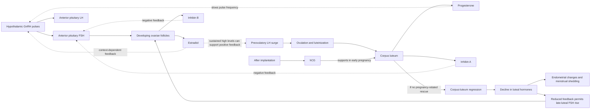

# Reproductive neuroendocrine network

**Status:** general-physiology reference for the Metheus candidate graph. This page is descriptive, not a clinical guide or an individual cycle interpretation.

Metheus represents reproductive physiology as a changing feedback network rather than a fixed calendar. The sequence below describes common patterns in human ovulatory cycles; cycle length, hormone patterns, ovulation, bleeding, and life-stage transitions vary. The catalog edges that support this sketch are candidates only: they remain `under_review`, `internal_only`, and unavailable to readings.

## A simplified cycle network

This diagram is intentionally simplified. GnRH is pulsatile; ovarian and pituitary responses depend on signal timing, duration, receptor sensitivity, and other local and systemic factors. Estradiol feedback is not a single-direction switch: its effect depends on concentration, duration, and physiological context. A single measurement cannot reveal the full feedback state.

## Phase-level orientation

| Network interval | Common physiology | What the model should avoid inferring |
|---|---|---|
| Follicular development | FSH supports follicular development. Estradiol and inhibin B from developing follicles contribute to feedback regulation of pituitary gonadotropins. | A calendar date alone does not identify follicle development, hormone concentrations, or ovulatory status. |
| Periovulatory interval | Sustained high estradiol can shift feedback and contribute to the LH surge; the surge promotes ovulation and luteinization. | An LH signal or symptom pattern alone does not confirm that ovulation occurred. |
| Luteal interval | The corpus luteum produces progesterone, estradiol, and inhibin A. Progesterone contributes to slower GnRH pulse frequency; ovarian signals participate in negative feedback. | A generic “luteal phase” label is not a measured progesterone state or a guaranteed fixed-duration interval. |
| Luteal-to-follicular transition when pregnancy does not occur | Corpus-luteum function regresses, luteal hormone output declines, endometrial changes can lead to menstrual shedding, and reduced feedback permits an FSH rise. | Bleeding does not prove ovulation or establish a complete hormone pattern. Bleeding can have other causes and contexts. |
| Early pregnancy | After implantation, hCG supports corpus-luteum function and progesterone production until placental steroid production becomes sufficient. | This pathway does not detect pregnancy, interpret hCG tests, or predict pregnancy outcome. |

The model should not assume a universal 28-day cycle, universal ovulation, or that every person has menstrual bleeding. Contraception, pregnancy, lactation, illness, medications, procedures, age, and individual variation can alter or interrupt these patterns. The phase labels are reference concepts, not diagnoses.

## Reproductive aging and menopause

Ovarian aging and the menopausal transition are not a single abrupt switch. Follicular activity and hormone patterns can vary during the transition. After menopause, depletion of the functional follicular pool is associated with lower ovarian estradiol and inhibin feedback and higher gonadotropins, including FSH. A single FSH result is not a stand-alone staging rule in this model; measurements need their clinical context and should not be converted into an individual status by Metheus.

Menopause should be represented as a life-stage context with uncertainty and history, rather than as a cycle phase inferred from wearable signals. The candidate graph provides no diagnostic or treatment function.

## Measurement boundary for Metheus

The repository can describe this graph and validate its source and schema references. It does not ingest or interpret laboratory results, establish ovulation, infer cycle phase from temperature or HRV, detect pregnancy or menopause, or estimate hormone levels from symptoms. If future features summarize user-entered or device measurements, they will need explicit provenance, collection timing, device/assay method, consent, and domain review; temporal coincidence must not be presented as a hormone mechanism or causal effect.

This biological graph remains separate from the Promethean/Human Design symbolic graph. Similar network shapes or evocative phase names do not establish biological equivalence or validate a Human Design association.

## Sources

- [Endotext: The Normal Menstrual Cycle and the Control of Ovulation](https://www.ncbi.nlm.nih.gov/books/NBK279054/) — follicular and luteal signaling, gonadotropin feedback, ovulation, corpus-luteum regression, menstrual shedding, and early-pregnancy support.
- [Endotext: Physiology of GnRH and Gonadotrophin Secretion](https://www.ncbi.nlm.nih.gov/books/NBK279070/) — pulsatile GnRH/gonadotropin regulation and steroid feedback.
- [Endotext: The Postmenopausal Women](https://www.ncbi.nlm.nih.gov/books/NBK279050/) — endocrine context after menopause.

These references support a starting general-physiology summary; listing them does not constitute an independent Metheus evidence review. The detailed statements remain candidate knowledge until the review process is completed for their exact wording and use.
