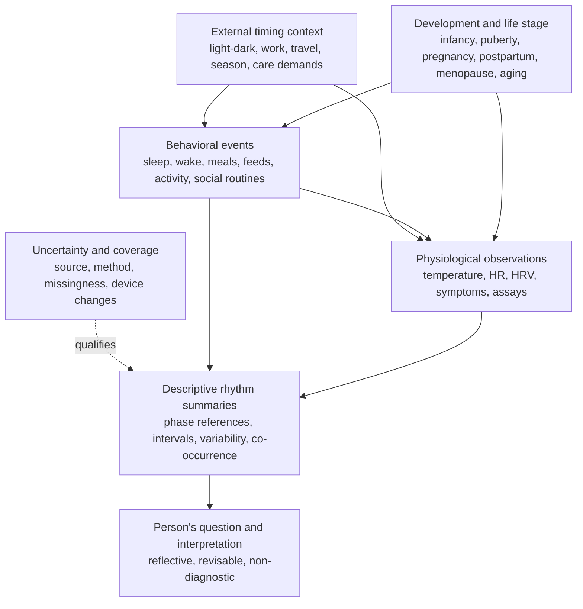

# Rhythm system model

**Status:** design specification, version 0.1. This describes how Metheus can organize observations about rhythms. It is not a validated circadian, nutrition, sleep, or clinical model, and does not prescribe a schedule.

## Why model rhythms together?

People live through overlapping time patterns. Sleep, light exposure, meals, activity, symptoms, hormone assays, social routines, and developmental change can all be relevant, but they are not the same process and do not run on one universal clock. A useful Metheus model keeps each time series separate, then makes their timing relationships inspectable.

Circadian systems are endogenous rhythms of approximately a day that are synchronized by environmental cycles. Light is a strong cue for the central circadian pacemaker, while meal timing can affect metabolic rhythms and peripheral clocks. The extent and meaning of any such relation for one person cannot be read directly from meal timestamps. This provides a rationale to model timing, not a basis to diagnose “misalignment” from a lifestyle log. See the review [Eating around the clock: circadian rhythms of eating and metabolism](https://pmc.ncbi.nlm.nih.gov/articles/PMC11849495/) and the [NIGMS overview of circadian rhythms](https://www.nigms.nih.gov/education/fact-sheets/Pages/circadian-rhythms.aspx).

## The rhythm stack



The arrows show possible contextual relationships for analysis, not proof of causal effects. Development and circumstance can alter both behaviors and physiology. Uncertainty qualifies every summary. A reading may ask about a pattern, but it must not convert a temporal association into a biological explanation.

## Keep three notions of time separate

Every timestamp is a civil-clock observation. It may also be compared to two useful references:

1. **Clock time:** local wall time, with IANA time zone where known. This changes meaning across travel, daylight-saving transitions, and time zones.
2. **Behavior-relative time:** elapsed time from an observed event such as waking or sleep onset. This is often useful for comparing a person's meals or activity with their own sleep schedule, including for shift workers.
3. **Biological phase:** a position in endogenous circadian timing. It is latent, not synonymous with clock time or sleep midpoint. Metheus should only store a phase estimate when the method is explicit, suitable measurements and protocol exist, and uncertainty is carried; otherwise use `unknown`.

Do not use the terms “early,” “late,” “aligned,” or “disrupted” without naming the reference. “Meal occurred 2.5 hours after the logged wake time” is reproducible; “meal was biologically late” requires evidence that an event log does not provide.

## Processes and features

| Process | Source events / measures | Descriptive features Metheus can derive | Keep distinct from |
|---|---|---|---|
| Light exposure | Sensor or self-reported outdoor/light event, duration and location only if needed | Recorded exposure by interval; timing relative to waking and sleep | Retinal light dose, melatonin suppression, or circadian phase unless measured under a validated protocol |
| Sleep / wake | Reported or device-estimated intervals; naps and awakenings | Duration, midpoint, onset/offset variability, interval overlap, wake-relative timing | Sleep stage, sleep quality, or adequate sleep if only inferred by consumer-device summaries |
| Eating / fasting pattern | Logged meal/snack/drink events, optionally food category and amount if the user chooses | Event count and timing, first-to-last logged span, time since wake, day-to-day variation | Complete intake, nutrient adequacy, metabolic state, or a recommended eating window |
| Infant feeding | Caregiver-reported feed start/duration/type only when useful and appropriate | Timing and recorded frequency in a specified window | Infant intake/adequacy, hunger state, sleep training target, or adult fasting metrics |
| Activity / rest | Wearable or manually logged activity and rest intervals | Timing, duration, reported intensity, relation to sleep/meal events | Fitness, energy expenditure, recovery, or health status unless separately measured and validated |
| Reproductive / hormonal | Bleeding, symptoms, pregnancy/postpartum events, assay results | Event-to-event intervals; assay values with specimen, time, and method | Assayed hormone from calendar day, temperature, HRV, mood, or symptoms alone |
| Autonomic / temperature | Heart rate, device HRV, measured temperature, device skin-temperature trend | Within-person time series and deviations from an explicit personal baseline | Neurochemical state, stress diagnosis, fertility, or core temperature from an unvalidated proxy |
| Experience and social rhythms | Self-reported mood, hunger/fullness, pain, energy, intimacy, caregiving, work or social events | Reported co-occurrence and timing | Another person's inner state, consent, or a universal causal mechanism |

Features should be derived only when source events support them. For example, `timeFromWakeMinutes` requires an observed wake anchor for that day. `LoggedEatingSpanMinutes` is the interval from first to last logged event, not a fasting duration if logging may be incomplete. A gap in records is missingness, not evidence of fasting, sleep, or inactivity.

## Multi-timescale representation

Use a common event timeline while retaining the natural scale of each process:

- **Seconds to hours:** sensor samples, short activity/rest bouts, awakenings, feeds, symptoms, meals.
- **Within-day / ultradian:** repeated sleep bouts, meal sequence, caregiver-led infant feeds, episodic symptoms, pulsatile processes that are only directly knowable when suitable sampling exists.
- **Daily / circadian:** rest-activity timing, light-dark exposure, eating occasions, temperature and other measured daily series.
- **Weekly and social:** work schedules, care schedules, weekday/weekend differences, repeated social routines.
- **Reproductive and transitional:** menstrual interval events, pregnancy, postpartum and lactation context, menopause transition, medication or care changes.
- **Developmental / life-course:** age and stage context, growth observations, evolving sleep and feeding patterns, puberty, caregiving transitions, aging.

Do not average across a transition as if the person were in a single stationary state. Summaries should show the time window and flag major context boundaries supplied by the person (for example, travel, shift change, illness, postpartum transition, or device replacement).

## Rhythm comparison workflow

1. **Select a question and window.** Examples: “How variable was my sleep midpoint during this work rotation?” or “How did my recorded meal times relate to my logged wake time?”
2. **Select available series.** Use only subject-authorized records with explicit provenance; distinguish self-report, caregiver report, sensor measurements, assays, and device-derived events.
3. **Choose the reference clock.** Local clock time, elapsed time from waking/sleep, or a defensible biological phase estimate. Do not silently substitute one for another.
4. **Check data sufficiency.** Report number of records, days covered, time-zone context, device/method changes, gaps, and whether events are likely incomplete.
5. **Compute descriptive features.** Prefer transparent quantities: intervals, medians, spread, co-occurrence, and within-person deviation. Show the method and source records. For repeated numeric measurements, fixed calendar buckets may display how the recorded distributions vary across the selected window; empty buckets stay visible, and no trend or personal baseline is inferred.
6. **Separate pattern from explanation.** First state the observed pattern, then offer alternative explanations and a question. Biological mechanisms remain hypotheses unless directly supported by evidence fit for that claim.
7. **Ask the person what matters.** The person may reject the pattern's relevance, add context, or choose not to track further.

## Infant and child rhythms

The infant model must represent development rather than enforce a clock-based adult template. It may support caregiver-reported sleep episodes, feeds, light/context, soothing or care events, and clinician-recorded growth when wanted. It should:

- preserve who observed or measured each event and distinguish actual duration from estimated timing;
- permit irregular, changing patterns and corrected age only when supplied and relevant;
- avoid adult meal windows, fasting summaries, caloric conclusions, fixed schedules, or normative scoring;
- avoid inferring a baby's hormone, emotion, attachment, or intention from behavior;
- keep records minimal, private, correctable, exportable, deletable, and progressively under the child's control.

## What a rhythm summary must disclose

Every future integrated summary should include:

```text
question + subject + window
series included + series omitted
time reference + time zone
coverage + gaps + source classes
device/assay/method versions
derived features + method version
observed pattern
uncertainty + plausible alternatives
non-claims and user feedback
```

## Implementation sequence

1. Keep the current sleep and meal summaries as single-series descriptive primitives.
2. Extend the event vocabulary for sleep episodes, light exposure, meal/snack, hydration, and activity only with clear source and privacy semantics. An explicit `wake` event and meal-to-wake summary are now represented in the schema and prototype.
3. Add further behavior-relative timing features only when an explicit anchor exists and the output explicitly reports incomplete logging.
4. Pairwise recorded temporal order and bounded cross-set temporal comparisons are executable helpers for same-subject observations, including interaction events when individually selected and authorized; broader multi-series co-occurrence, lag analysis, and change-point/context handling remain design work and must stay descriptive, not diagnostic or prescriptive. Cross-set comparisons state only time order/overlap, never a relation between intimacy and physiology.
5. Consider biological phase estimates only after method review and user testing. They are not required for a useful system.
6. Review developmental and nutrition-related behavior with relevant domain experts before making product claims or recommendations.

The current executable prototype summarizes explicitly logged main sleep, meals and caregiver-reported feeding events in separate outputs, compares meal events with explicit wake anchors, describes calendar gaps between reported bleeding-onset dates and same-signature numeric measurement series, and compares the recorded time windows of two selected records. It does not infer menstrual phase, ovulation, hormone dynamics, health status, or a multi-series association. Broader rhythm analysis remains design work, not implemented functionality.
